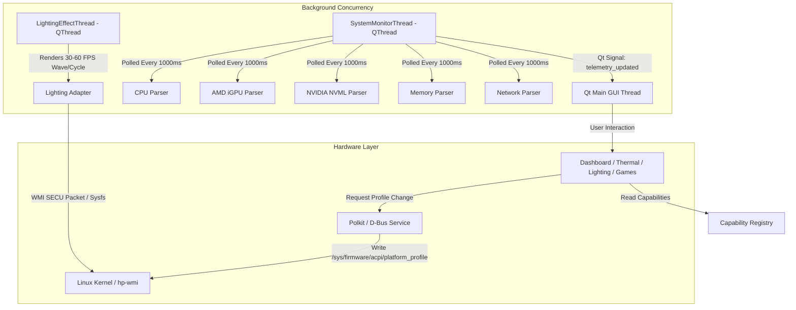

# NUXARCHY: System Architecture & Design

## 1. Technology Stack Selection & Evaluation

| Evaluation Criteria | Qt 6 / PySide6 | Qt 6 / C++ | Tauri + Rust | GTK 4 / Libadwaita |
| :--- | :--- | :--- | :--- | :--- |
| **Wayland & Hyprland Compatibility** | **Excellent** (Native QtWayland backend) | Excellent | Good (WebKitGTK Wayland quirks) | Excellent |
| **Hardware Access & Probing** | **Outstanding** (Python standard library + ctypes/NVML) | Strong (Requires verbose C/C++ bindings) | Strong (Rust crates) | Medium |
| **Visual Customization & Dark Theme** | **Outstanding** (QSS stylesheets + custom painted widgets) | Outstanding | Outstanding (HTML/CSS) | Constrained by GNOME HIG guidelines |
| **Asynchronous Threading & Responsiveness** | **First-class** (`QThread`, `Signal`/`Slot`) | First-class | First-class (Tokio) | Good |
| **Packaging & Maintenance on Arch** | **Native** (`python-pyside6` in Arch official repos) | High build times & CMake overhead | Heavy WebKit dependencies | Native |

### Stack Decision: Qt 6 with PySide6 (Python)
- **Primary Framework**: Qt 6 via PySide6 (`python-pyside6`).
- **Telemetry & Low-Level Interfaces**: Linux `/proc`, `/sys`, NVML (`libnvidia-ml.so.1` via ctypes/pynvml), D-Bus (`power-profiles-daemon`).
- **Styling Architecture**: Custom dark cyber/OMEN theme with high-contrast accent colors (Electric Turquoise `#00FFD1`, Omen Red `#FF2A54`, Cyber Violet `#9D4EDD`, Dark Titanium `#121318`).
- **Safety Model**: Least-privilege UI process communicating with a narrowly-scoped Polkit helper daemon for hardware modifications.

---

## 2. Component Organization & Directory Layout

```
nuxarchy/
├── app/
│   ├── __init__.py
│   ├── main.py                     # Application entry point & Qt setup
│   ├── resources.py                # Asset, SVG icons & color palette constants
│   ├── style.qss                   # Polished dark gaming stylesheet
│   └── ui/
│       ├── __init__.py
│       ├── main_window.py          # Master window with sidebar navigation
│       ├── widgets/
│       │   ├── gauge_card.py       # Circular/bar hardware telemetry card
│       │   ├── history_chart.py    # Real-time hardware telemetry graph
│       │   └── status_banner.py    # Hardware capability alert banner
│       ├── views/
│       │   ├── dashboard_view.py   # System Dashboard (CPU, GPU, RAM, Net)
│       │   ├── performance_view.py # Power profiles, EPP, CPU governors
│       │   ├── thermal_view.py     # Thermal monitors, fans & cooling modes
│       │   ├── gpu_view.py         # Hybrid / Discrete graphics management
│       │   ├── lighting_view.py    # OMEN Light Studio 4-zone RGB controller
│       │   ├── games_view.py       # Game library, Steam auto-discovery & booster
│       │   ├── diagnostics_view.py # Hardware info, DMI, PCIe & health audit
│       │   └── settings_view.py    # Application settings, refresh rates, themes
│
├── backend/
│   ├── __init__.py
│   ├── capability.py               # Hardware capability discovery engine
│   ├── telemetry/
│   │   ├── __init__.py
│   │   ├── system_monitor.py       # Master background telemetry worker (QThread)
│   │   ├── cpu_monitor.py          # /proc/stat, cpufreq, k10temp parser
│   │   ├── gpu_amd_monitor.py      # amdgpu DRM & hwmon parser
│   │   ├── gpu_nvidia_monitor.py   # NVML C bindings & nvidia-smi fallback
│   │   ├── memory_monitor.py       # /proc/meminfo parser
│   │   └── network_monitor.py      # /proc/net/dev throughput parser
│   ├── adapters/
│   │   ├── __init__.py
│   │   ├── platform_profile.py     # ACPI platform-profile adapter
│   │   ├── fan_controller.py       # Hardware fan control & safety verification
│   │   └── lighting_adapter.py     # WMI SECU packet & OpenRGB lighting adapter
│   └── games/
│       ├── __init__.py
│       └── library_scanner.py      # Steam & Linux native game discovery
│
├── services/
│   ├── __init__.py
│   ├── privileged_helper.py        # Privileged hardware helper script
│   └── profile_manager.py          # User settings & profile persistence
│
├── packaging/
│   ├── com.nuxarchy.hub.desktop
│   ├── com.nuxarchy.hub.policy     # Polkit action definition
│   ├── PKGBUILD                    # Native Arch Linux package build recipe
│   └── icons/                      # Application icons
│
├── tests/
│   ├── test_hardware_detection.py
│   ├── test_telemetry_parsers.py
│   ├── test_lighting_packet.py
│   └── test_capability_registry.py
│
└── docs/
    ├── REFERENCE_ANALYSIS.md
    ├── FEATURE_MATRIX.md
    ├── HARDWARE_COMPATIBILITY.md
    ├── ARCHITECTURE.md
    ├── IMPLEMENTATION_PLAN.md
    └── SECURITY_MODEL.md
```

---

## 3. Asynchronous Concurrency Model



- **Thread Safety**: The UI thread never performs blocking file reads, network calls, or hardware queries. All sensor polling is contained within `SystemMonitorThread`.
- **Throttling & Efficiency**: Telemetry intervals are user-configurable (default: 1.0s). When the window is minimized or inactive, polling can throttle back to reduce CPU usage to <0.5%.
- **Safe Failure Guarantee**: If any sensor sysfs file is missing or unreadable, the parser safely returns `None` and records a diagnostic trace without crashing the application. Unavailable metrics in the UI display clean `"N/A"` or `"--"` badges.
